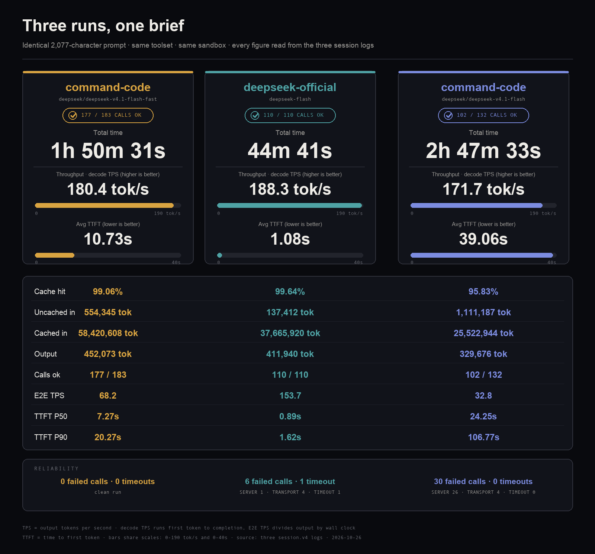

# Benchmark Session Archive

Three DSH runs of the same benchmark brief, one per provider/model pair. Each
folder holds that run's session log and the single-file HTML artifact it produced.

All three runs received a byte-identical prompt (2077 characters, SHA-256
`7e995d05ea05`): build a self-contained `index.html` with an evolving
plants/prey/predators ecosystem simulation, seeded PRNG, gene vectors or tiny
neural nets, mutations on reproduction, live controls, catastrophes, and an
end-of-run dashboard with population and trait-drift charts.

## Layout

```
Test/
|-- command-code--deepseek-v4.1-flash-fast/
|   |-- command-code--deepseek-v4.1-flash-fast.html
|   |-- command-code--deepseek-v4.1-flash-fast.mp4
|   |-- session-command-code--deepseek-v4.1-flash-fast-session.v4.redacted.jsonl
|   `-- session-command-code--deepseek-v4.1-flash-fast-session.v4.redacted.jsonl.zstd
|-- deepseek-official--deepseek-flash/
|   |-- deepseek-official--deepseek-flash.html
|   |-- deepseek-official--deepseek-flash.mp4
|   |-- session-deepseek-official--deepseek-flash-session.v4.redacted.jsonl
|   `-- session-deepseek-official--deepseek-flash-session.v4.redacted.jsonl.zstd
|-- command-code--deepseek-v4.1-flash/
|   |-- command-code--deepseek-v4.1-flash.html
|   |-- command-code--deepseek-v4.1-flash.mp4
|   |-- command-code--deepseek-v4.1-flash--probe.txt
|   |-- session-command-code--deepseek-v4.1-flash-session.v4.redacted.jsonl
|   `-- session-command-code--deepseek-v4.1-flash-session.v4.redacted.jsonl.zstd
|-- comparison.png
`-- README.md
```

Directory names are `<provider>--<model>`; the session identifier inside each log
is `session-<provider>--<model>` and matches its directory.

## Runs

| Directory | Provider | Model (route field) | Records | Turns | User msgs | Tool calls | Span |
|---|---|---|---|---|---|---|---|
| `command-code--deepseek-v4.1-flash-fast` | `command-code` | `deepseek/deepseek-v4.1-flash-fast` | 1265 | 1 | 17 | 235 | 6631s |
| `deepseek-official--deepseek-flash` | `deepseek-official` | `deepseek-flash` | 842 | 1 | 8 | 112 | 2681s |
| `command-code--deepseek-v4.1-flash` | `command-code` | `deepseek/deepseek-v4.1-flash` | 832 | 3 | 24 | 111 | 10053s |

Every run used `agentPreset: standard`, the `workspace-write` sandbox, and the
`ask` approval policy. Provider and model are read from the `model/selection`,
`data/route`, and `request/header` records, not inferred from directory names.

## Comparison

Same brief, same tooling, same sandbox.



| Metric | command-code / v4.1-flash-fast | deepseek-official / flash | command-code / v4.1-flash |
|---|---|---|---|
| Duration (wall) | 6631s (1h50m31s) | 2681s (44m41s) | 10053s (2h47m33s) |
| Model calls ok / attempted | 177 / 183 | 110 / 110 | 102 / 132 |
| Output tokens | 452,073 | 411,940 | 329,676 |
| Uncached input | 554,345 | 137,412 | 1,111,187 |
| Cached input | 58,420,608 | 37,665,920 | 25,522,944 |
| Total input (cached + uncached) | 58,974,953 | 37,803,332 | 26,634,131 |
| Cache hit rate | 99.06% | 99.64% | 95.83% |
| TPS (decode) | 180.4 | 188.3 | 171.7 |
| TPS (end-to-end) | 68.2 | 153.7 | 32.8 |
| Avg TTFT | 10.73s | 1.08s | 39.06s |
| TTFT P50 | 7.27s | 0.89s | 24.25s |
| TTFT P90 | 20.27s | 1.62s | 106.77s |
| TTFT max | 89.11s | 5.08s | 171.54s |
| Calls failed | 6 | 0 | 30 |
| Timeouts | 1 | 0 | 0 |
| Failure codes | `TRANSPORT` 4, `TIMEOUT` 1, `SERVER` 1 | - | `TRANSPORT` 4, `SERVER` 26 |
| Success rate | 96.7% | 100% | 77.3% |
| Decode time (sum) | 2506.5s | 2188.2s | 1919.7s |
| Total tokens (in + cached + out) | 59,427,026 | 38,215,272 | 26,963,807 |

## Metric definitions

* Duration: the last logged event's timestamp. Every timestamp is milliseconds
  relative to `t0`, the moment the first user message entered the session, so
  duration runs from first request to session end and includes tool execution.
* Model call: one `assistant/message` record carrying a `usage` block. A call
  that failed before producing a message leaves an `assistant/attempt` record
  plus an `llm/retry` record instead.
* Uncached input: sum of `usage.inputTokens`. Cached input: sum of
  `usage.cacheReadTokens`. Output: sum of `usage.outputTokens`. The harness also
  logs `usage.totalTokens`, which equals uncached + cached + output.
* Cache hit rate: cached input / (cached input + uncached input).
* TPS (decode): output tokens / sum of per-call decode spans, where a span runs
  from the first stream event to the completion record.
* TPS (end-to-end): output tokens / duration, so tool execution and retry waits
  are included.
* TTFT: first stream event time minus the request start of that call. Request
  start is the `step/start` timestamp, or the `llm/retry-started` timestamp when
  the surviving attempt followed retries. Averages cover successful calls;
  percentiles use linear interpolation between order statistics.
* Calls failed: `llm/retry` records. Timeouts: those whose `failure.code` is
  `TIMEOUT`. Success rate: ok / (ok + failed).

## Artifacts

The HTML files are byte-identical to the `index.html` each run produced.

| File | Bytes | SHA-256 prefix |
|---|---|---|
| `command-code--deepseek-v4.1-flash-fast.html` | 203076 | `c40173e20ff3bfd4` |
| `deepseek-official--deepseek-flash.html` | 220490 | `27ac60c6ae16f78a` |
| `command-code--deepseek-v4.1-flash.html` | 216478 | `b324544172127e3d` |

All three are self-contained single-file pages with inline CSS and JS. The only
`http://` strings inside them are SVG XML namespace declarations; no external
script, font, image, or API is loaded.

`command-code--deepseek-v4.1-flash--probe.txt` is a 5-byte scratch file left in
that run's workspace, kept for completeness.

## Comparison assets

`comparison.png` (1600x1490) is a three-column scorecard: one card per run with
its provider, model, total time, decode throughput and average TTFT as oversized
figures over shared-scale bars, then a full-width table for cache and token
counts, plus a reliability band with the failure breakdown.

Each run folder carries a `<case>.mp4` screen recording of that run's artifact:

| Clip | Length | Resolution | Audio |
|---|---|---|---|
| `command-code--deepseek-v4.1-flash-fast.mp4` | 37.4s | 1680x1092, 30fps, H.264 | AAC |
| `deepseek-official--deepseek-flash.mp4` | 41.1s | 1680x1092, 30fps, H.264 | AAC |
| `command-code--deepseek-v4.1-flash.mp4` | 31.4s | 1680x1092, 30fps, H.264 | AAC |

Each clip plays that run's page live and ends on the page's own end state:

* VITARIUM (v4.1-flash-fast) closes on the retrospective plate, 480 generations,
  9 disturbance windows, 3 860 virens / 255 lepus / 39 vulpes.
* VIVARIUM (deepseek-flash) closes on the sealed-world report, 240 of 240
  generations observed, 8 disturbances weathered.
* The Nocturnal Vivarium (v4.1-flash) closes at generation 36 / 36 with the
  specimen sealed and the field report offered.

## Provenance

| Archive directory | Live session |
|---|---|
| `command-code--deepseek-v4.1-flash-fast` | `~/.dsh/sessions/--Users-<user>-Documents-Workspace-bench--/session-cb9c84c8-6a7c-4b4c-8653-820270035be9/` |
| `deepseek-official--deepseek-flash` | `~/.dsh/sessions/--Users-<user>-Documents-Workspace-bench2--/session-f0eb797a-c854-44ec-98a5-d0c6661342a4/` |
| `command-code--deepseek-v4.1-flash` | `~/.dsh/sessions/--Users-<user>-Documents-Workspace-bench3--/session-cdcb5653-f925-4b89-8534-e3a3aa749102/` |

Each source workspace also held one short aborted session (37, 26, and 4 records,
no artifact). Those were dropped; every archived run is the session that produced
the HTML beside it.
